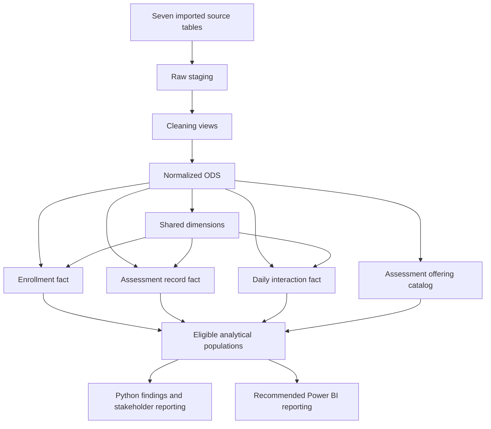
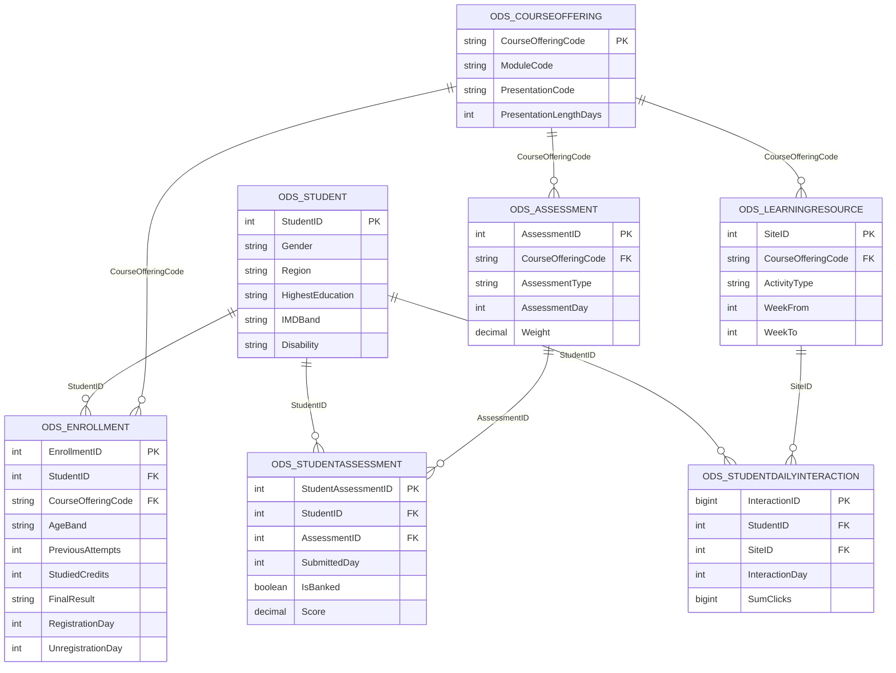
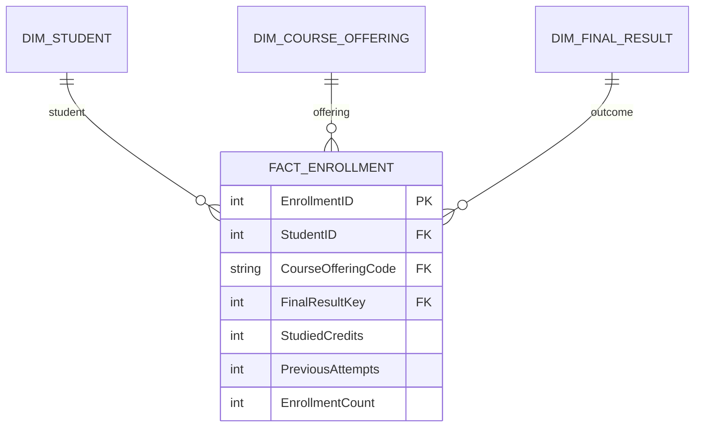
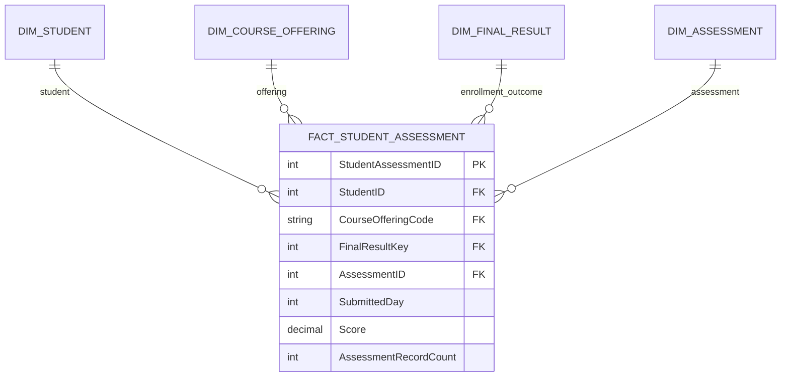
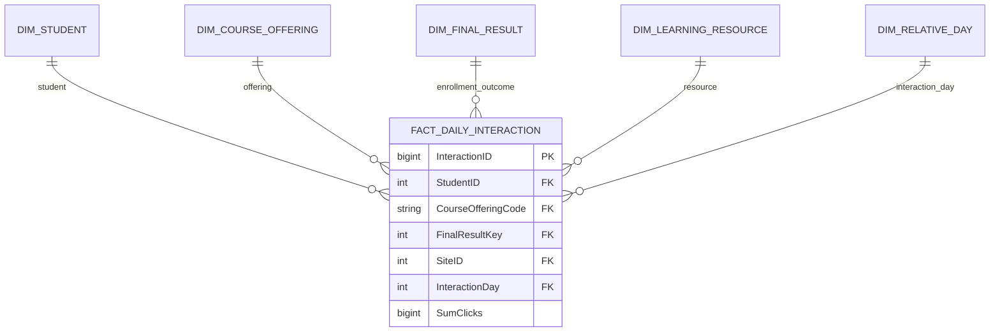

# Stage 0 — OULAD: Source Mapping, Normalization, Star Schema, and ERD

**Project:** OULAD — Student Outcomes, Assessment Completion and Learning Engagement  
**Source files:** `courses.csv`, `assessments.csv`, `vle.csv`, `studentInfo.csv`, `studentRegistration.csv`, `studentAssessment.csv`, `studentVle.csv`  
**Implementation scripts:** `1- OULAD_staging(1).sql`, `02_OULAD_clean_views(2).sql`, `Normalization(2).sql`, `Denromalization(1).sql`  
**Target platform:** Microsoft SQL Server (T-SQL), Python/pandas and a recommended Power BI semantic model  
**Documentation date:** 28 October 2026

This document follows the supplied HR schema-mapping template and describes the OULAD implementation actually present in the supplied scripts. “Stage 0” identifies the design/mapping document; it does not imply that this file was produced before the implementation or that the SQL was executed again during preparation.

It answers four questions:

1. What does each source file contain, and what are its grain and business keys?
2. How are sources cleaned and separated into the ODS model?
3. How are ODS entities mapped and enriched into three analytical facts with shared dimensions?
4. Which relationships are physically declared in SQL, and which are recommended for Power BI?

---

## 1. Business purpose

The stakeholder problem is **withdrawal or academic failure affecting 17,208 of 32,593 enrollments (52.80%)**. Withdrawal represents 31.16% and failure 21.64%; overall success, including distinction, is 47.20%.

The model supports analysis of outcomes, withdrawal timing, study load, previous attempts, prior education, deprivation, assessment completion and learning engagement. Its management purpose is to guide targeted support: CCC and DDD by combined outcome rate, BBB and FFF by affected case volume, GGG for academic performance, and students facing high workloads, unresolved learning gaps or access barriers.

**The central analytical unit is one student enrollment in one module presentation.** The 32,593 enrollments belong to 28,785 distinct students across seven modules and 22 presentations in 2013–2014. Student count and enrollment count are different measures. Findings are descriptive associations, not established causal effects or validated individual predictions.

---

## 2. Source inventory

The source inventory below is grounded in the supplied staging definitions. Original CSV bytes and fresh staging/source count results were not supplied. Therefore, no raw CSV row counts are asserted here.

| Source / initially imported table | Columns | Intended grain | Business key / target grain |
|---|---:|---|---|
| `courses.csv` / `dbo.courses` | 3 | One module presentation | `(code_module, code_presentation)` |
| `assessments.csv` / `dbo.assessments` | 6 | One assessment | `id_assessment` |
| `vle.csv` / `dbo.vle` | 6 | One resource in a module presentation | `id_site` is globally unique in the implemented target |
| `studentInfo.csv` / `dbo.studentInfo` | 12 | One enrollment | `(id_student, code_module, code_presentation)` |
| `studentRegistration.csv` / `dbo.studentRegistration` | 5 | One enrollment | `(id_student, code_module, code_presentation)` |
| `studentAssessment.csv` / `dbo.studentAssessment` | 5 | One student–assessment record | `(id_student, id_assessment)` |
| `studentVle.csv` / `dbo.studentVle` | 6 | One source interaction record | Target grouping: student + module + presentation + resource + day; raw uniqueness is not assumed |

### 2.1 Recorded warehouse-profile results

These figures come from saved outputs in `Final_OULAD_Analysis(6).ipynb`, not from a new database run or a count of original CSV files.

| Check | Recorded result |
|---|---:|
| Warehouse tables | 9 |
| Student dimension rows | 28,785 |
| Course-offering dimension rows | 22 |
| Assessment dimension rows | 206 |
| Resource dimension rows | 6,364 |
| Outcome / relative-day dimension rows | 5 / 974 |
| Enrollment fact rows | 32,593 |
| Assessment-record fact rows | 173,912 |
| Daily interaction fact rows | 8,459,320 |
| Key combinations passing missing/duplicate checks | 14 of 14 |
| Declared foreign-key relationships passing checks | 12 of 12 |
| Null keys / orphan rows in checked relationships | 0 / 0 |
| Enrollment dimension joins | 32,593 rows retained, zero unmatched for each join |
| Enrollments with / without interaction records | 29,228 / 3,365 |
| Unknown enrollment outcomes | 0 |

Structural integrity does not imply complete descriptive attributes or complete behavioral records. Raw-to-clean duplicate counts and raw click reconciliation were not supplied as saved results.

---

## 3. Source entities and relationships

| Entity | Derived from | Meaning and grain |
|---|---|---|
| Student | Stable attributes from studentInfo | One person, identified by original StudentID. |
| Course Offering | courses | One module delivered in one presentation. |
| Enrollment | studentInfo + studentRegistration | A student's participation, outcome, age band, study load and attempts in a particular offering. |
| Assessment | assessments | One assessment definition belonging to one offering. |
| Student Assessment | studentAssessment | A recorded result/submission for one student and assessment, including banked results. |
| Learning Resource | vle | One resource belonging to one offering, with activity type and planned availability weeks. |
| Daily Interaction | studentVle | Retained clicks aggregated to one student × resource × relative day. |
| Final Result | Fixed warehouse lookup | PASS, DISTINCTION, FAIL, WITHDRAWN and UNKNOWN classification members. |
| Relative Day | Generated from ODS day bounds | Signed offset from course start, with study-week and pre-start attributes. |

One student may have multiple enrollments. One offering may contain multiple enrollments, assessments and resources. Each assessment record must match an enrollment in the assessment's offering; each interaction must match an enrollment in the resource's offering. The latter two rules are enforced during loading and warehouse validation; they are not physical EnrollmentID foreign keys in the ODS.

---

## 4. Source-to-target mapping

Every raw staging column has the **same name and order as the CSV column** and is stored as **NVARCHAR(255) NULL**. Each table below identifies the staging table and its matching cleaning view. ODS and DW paths are qualified explicitly; indirect mappings identify where context is resolved rather than implying a nonexistent column.

All seven views apply `UPPER(TRIM(...))`, map empty strings / `?` / `NULL` / `N/A` to NULL, remove exact normalized duplicate rows using ROW_NUMBER over all source columns, and then convert numeric types. Conflicting business-key variants are not resolved by this deduplication rule.

### 4.1 `courses.csv` mapping

**Staging:** `stg.raw_courses`.  
**Cleaning view:** `stg.vw_clean_courses`.

| CSV / staging column | ODS target | DW target | Main transformation / rule |
|---|---|---|---|
| `code_module` | `ods.CourseOffering.ModuleCode` | `dw.DimCourseOffering.ModuleCode` | Normalize case/whitespace and missing markers; resolve the matching module presentation. First character contributes to CourseOfferingCode. |
| `code_presentation` | `ods.CourseOffering.PresentationCode` | `dw.DimCourseOffering.PresentationCode`; `dw.DimCourseOffering.PresentationYear`; `dw.DimCourseOffering.PresentationTerm` | Normalize; parse year from first four characters and term from final character in DW. |
| `module_presentation_length` | `ods.CourseOffering.PresentationLengthDays` | `dw.DimCourseOffering.PresentationLengthDays` | TRY_CAST to INT; positive values only, otherwise NULL. |

### 4.2 `studentInfo.csv` mapping

**Staging:** `stg.raw_studentInfo`.  
**Cleaning view:** `stg.vw_clean_studentInfo`.

| CSV / staging column | ODS target | DW target | Main transformation / rule |
|---|---|---|---|
| `code_module` | `ods.Enrollment.CourseOfferingCode`, via CourseOffering | `dw.FactEnrollment.CourseOfferingCode` | Resolve offering using full module + presentation; do not join on student alone. |
| `code_presentation` | `ods.Enrollment.CourseOfferingCode`, via CourseOffering | `dw.FactEnrollment.CourseOfferingCode` | Use with code_module and id_student to identify the enrollment. |
| `id_student` | `ods.Student.StudentID`; `ods.Enrollment.StudentID` | `dw.DimStudent.StudentID`; `dw.FactEnrollment.StudentID` | TRY_CAST to positive INT; stable source identifier, not a generated student surrogate. |
| `gender` | `ods.Student.Gender` | `dw.DimStudent.Gender` | Normalize text; ODS CHECK accepts M/F or NULL. |
| `region` | `ods.Student.Region` | `dw.DimStudent.Region` | Normalize text; preserved as a descriptive category. |
| `highest_education` | `ods.Student.HighestEducation` | `dw.DimStudent.HighestEducation` | Normalize text; used for prior-education comparisons. |
| `imd_band` | `ods.Student.IMDBand` | `dw.DimStudent.IMDBand` | Normalize missing markers; lower bands indicate greater deprivation. |
| `age_band` | `ods.Enrollment.AgeBand` | `dw.FactEnrollment.AgeBand` | Retain at enrollment grain; do not move to a one-profile student dimension. |
| `num_of_prev_attempts` | `ods.Enrollment.PreviousAttempts` | `dw.FactEnrollment.PreviousAttempts` | TRY_CAST to nonnegative INT; count of earlier attempts at the same module. |
| `studied_credits` | `ods.Enrollment.StudiedCredits` | `dw.FactEnrollment.StudiedCredits` | TRY_CAST to nonnegative INT; total study load at enrollment. |
| `disability` | `ods.Student.Disability` | `dw.DimStudent.Disability` | Normalize text; ODS CHECK accepts Y/N or NULL. |
| `final_result` | `ods.Enrollment.FinalResult` | `dw.DimFinalResult.FinalResult`; `dw.FactEnrollment.FinalResultKey` | Normalize outcome; lookup mapping adds the key. The same enrollment key classification enriches both behavioral facts. |

### 4.3 `studentRegistration.csv` mapping

**Staging:** `stg.raw_studentRegistration`.  
**Cleaning view:** `stg.vw_clean_studentRegistration`.

| CSV / staging column | ODS target | DW target | Main transformation / rule |
|---|---|---|---|
| `code_module` | `ods.Enrollment.CourseOfferingCode`, via CourseOffering | `dw.FactEnrollment.CourseOfferingCode` | Join studentInfo on student + full module + presentation. |
| `code_presentation` | `ods.Enrollment.CourseOfferingCode`, via CourseOffering | `dw.FactEnrollment.CourseOfferingCode` | Source key sets are checked in both directions before the join. |
| `id_student` | `ods.Enrollment.StudentID` | `dw.FactEnrollment.StudentID` | TRY_CAST to positive INT; match to the enrollment defined by studentInfo. |
| `date_registration` | `ods.Enrollment.RegistrationDay` | `dw.FactEnrollment.RegistrationDay` | TRY_CAST to signed INT; retain valid negative pre-start offsets and NULL. |
| `date_unregistration` | `ods.Enrollment.UnregistrationDay` | `dw.FactEnrollment.UnregistrationDay` | TRY_CAST to signed INT; preserve NULL and review outcome/timing consistency in analysis. |

### 4.4 `assessments.csv` mapping

**Staging:** `stg.raw_assessments`.  
**Cleaning view:** `stg.vw_clean_assessments`.

| CSV / staging column | ODS target | DW target | Main transformation / rule |
|---|---|---|---|
| `code_module` | `ods.Assessment.CourseOfferingCode`, via CourseOffering | `dw.FactStudentAssessment.CourseOfferingCode`, via Assessment and Enrollment | Resolve module presentation; no CourseOfferingCode column exists in DimAssessment. |
| `code_presentation` | `ods.Assessment.CourseOfferingCode`, via CourseOffering | `dw.FactStudentAssessment.CourseOfferingCode`, via Assessment and Enrollment | Use full module + presentation to resolve ownership. |
| `id_assessment` | `ods.Assessment.AssessmentID` | `dw.DimAssessment.AssessmentID`; `dw.FactStudentAssessment.AssessmentID` | TRY_CAST to positive INT; retain original identifier. |
| `assessment_type` | `ods.Assessment.AssessmentType` | `dw.DimAssessment.AssessmentType` | Normalize text; ODS CHECK allows TMA/CMA/EXAM. |
| `date` | `ods.Assessment.AssessmentDay` | `dw.DimAssessment.AssessmentDay` | TRY_CAST to signed INT, not DATE. Deadline analysis excludes unknown/invalid timing. |
| `weight` | `ods.Assessment.Weight` | `dw.DimAssessment.Weight` | TRY_CAST to DECIMAL(6,2); retain values between 0 and 100, otherwise NULL. |

### 4.5 `studentAssessment.csv` mapping

**Staging:** `stg.raw_studentAssessment`.  
**Cleaning view:** `stg.vw_clean_studentAssessment`.

| CSV / staging column | ODS target | DW target | Main transformation / rule |
|---|---|---|---|
| `id_assessment` | `ods.StudentAssessment.AssessmentID` | `dw.FactStudentAssessment.AssessmentID` | Resolve Assessment and its offering; retain banked as well as current records. |
| `id_student` | `ods.StudentAssessment.StudentID` | `dw.FactStudentAssessment.StudentID` | Resolve a valid enrollment in the assessment offering; positive source INT. |
| `date_submitted` | `ods.StudentAssessment.SubmittedDay` | `dw.FactStudentAssessment.SubmittedDay` | TRY_CAST to signed INT; timing eligibility is separate from existence of the record. |
| `is_banked` | `ods.StudentAssessment.IsBanked` | `dw.FactStudentAssessment.IsBanked` | Clean to INT 0/1 or NULL, then store as BIT. Banked results are not current submissions. |
| `score` | `ods.StudentAssessment.Score` | `dw.FactStudentAssessment.Score` | TRY_CAST to DECIMAL(6,2); retain 0–100; missing remains NULL, not zero. |

### 4.6 `vle.csv` mapping

**Staging:** `stg.raw_vle`.  
**Cleaning view:** `stg.vw_clean_vle`.

| CSV / staging column | ODS target | DW target | Main transformation / rule |
|---|---|---|---|
| `id_site` | `ods.LearningResource.SiteID` | `dw.DimLearningResource.SiteID`; `dw.FactDailyInteraction.SiteID` | TRY_CAST to positive INT; original globally unique resource key in this implementation. |
| `code_module` | `ods.LearningResource.CourseOfferingCode`, via CourseOffering | `dw.FactDailyInteraction.CourseOfferingCode`, via LearningResource | Resolve module presentation; ownership is not a column of DimLearningResource. |
| `code_presentation` | `ods.LearningResource.CourseOfferingCode`, via CourseOffering | `dw.FactDailyInteraction.CourseOfferingCode`, via LearningResource | Use full module + presentation to resolve ownership. |
| `activity_type` | `ods.LearningResource.ActivityType` | `dw.DimLearningResource.ActivityType` | Normalize text; retain activity category. |
| `week_from` | `ods.LearningResource.WeekFrom` | `dw.DimLearningResource.WeekFrom` | TRY_CAST to INT; NULL remains NULL; no WeekFrom ≤ WeekTo CHECK is declared. |
| `week_to` | `ods.LearningResource.WeekTo` | `dw.DimLearningResource.WeekTo` | TRY_CAST to INT; retain source planned resource-availability week. |

### 4.7 `studentVle.csv` mapping

**Staging:** `stg.raw_studentVle`.  
**Cleaning view:** `stg.vw_clean_studentVle`.

| CSV / staging column | ODS target | DW target | Main transformation / rule |
|---|---|---|---|
| `code_module` | `ods.StudentDailyInteraction` via CourseOffering, LearningResource and Enrollment | `dw.FactDailyInteraction.CourseOfferingCode` | Participates in aggregation and validates resource/enrollment ownership. |
| `code_presentation` | `ods.StudentDailyInteraction` via CourseOffering, LearningResource and Enrollment | `dw.FactDailyInteraction.CourseOfferingCode` | Participates in aggregation; offering is stored on the DW interaction fact. |
| `id_student` | `ods.StudentDailyInteraction.StudentID` | `dw.FactDailyInteraction.StudentID` | TRY_CAST to positive INT; match enrollment in the resource offering. |
| `id_site` | `ods.StudentDailyInteraction.SiteID` | `dw.FactDailyInteraction.SiteID` | TRY_CAST to positive INT; match resource in the source module presentation. |
| `date` | `ods.StudentDailyInteraction.InteractionDay` | `dw.FactDailyInteraction.InteractionDay`; `dw.DimRelativeDay.RelativeDay` | TRY_CAST to signed INT; relative-day dimension includes negative values and day 0. |
| `sum_click` | `ods.StudentDailyInteraction.SumClicks` | `dw.FactDailyInteraction.SumClicks` | TRY_CAST to nonnegative BIGINT; SUM after normalized full-row deduplication at student × offering × resource × day grain. |

### 4.8 Generated keys, counters and lookup mappings

| Target | Generation / mapping rule | Important distinction |
|---|---|---|
| `ods.CourseOffering.CourseOfferingCode` | `LEFT(code_module, 1) + code_presentation` | AAA + 2013J produces **A2013J**, not AAA2013J. |
| `ods.Enrollment.EnrollmentID` | INT IDENTITY(1,1) | Copied into FactEnrollment; not regenerated there. |
| `ods.StudentAssessment.StudentAssessmentID` | INT IDENTITY(1,1) | Copied into FactStudentAssessment. |
| `ods.StudentDailyInteraction.InteractionID` | BIGINT IDENTITY(1,1) | Copied into FactDailyInteraction. |
| `dw.DimFinalResult` | 0 UNKNOWN; 1 PASS; 2 DISTINCTION; 3 FAIL; 4 WITHDRAWN | IsSuccess = 1 only for PASS/DISTINCTION; IsWithdrawn = 1 only for WITHDRAWN. |
| All three fact `FinalResultKey` columns | Resolve from the matching enrollment; NULL outcome maps to UNKNOWN | Behavioral facts carry enrollment outcome for retrospective comparisons. |
| `dw.FactEnrollment.EnrollmentCount` | Constant 1 with CHECK constraint | Additive enrollment counter. |
| `dw.FactStudentAssessment.AssessmentRecordCount` | Constant 1 with CHECK constraint | Counts observed records, including banked; not expected opportunities. |
| `dw.DimRelativeDay` | Generate every integer between overall ODS day bounds, including 0 | Covers interaction, submission, deadline, registration and unregistration bounds. |

### 4.9 Data types and relative time

Source student, assessment and resource identifiers become INT. ODS enrollment and assessment-record surrogate keys are INT IDENTITY; interaction surrogate keys are BIGINT IDENTITY. Score and weight use DECIMAL(6,2); SumClicks uses BIGINT; IsBanked uses BIT. DW source/surrogate keys retain ODS values without IDENTITY generation.

Registration, unregistration, submission, deadline and interaction fields are signed **INT relative days**, not calendar dates. Negative values may represent valid pre-start events. There is no calendar-date conversion or calendar DimDate in this warehouse.

---

## 5. Layered pipeline architecture

| Layer | Objects | Role |
|---|---|---|
| Initially imported source | Seven dbo tables | SQL inputs assumed by the staging script. |
| Raw staging | Seven stg.raw tables | Preserve imported fields as text in source order. |
| Cleaning | Seven stg views | Normalize missing markers/text, deduplicate identical normalized rows and convert types. |
| ODS | Seven tables | Separate student, offering, enrollment, assessment, submission, resource and daily interaction entities. |
| DW | Six dimensions + three facts | Enrich behavioral facts with offering/outcome context and expose shared dimensions. |
| Python analysis | Notebook-derived populations and summaries | Validate joins; construct expected opportunities and eligible observation windows. |
| Power BI | Recommended semantic model | Use shared dimension filtering and explicit cohort-aware measures; implementation not supplied. |

The expected-assessment catalog retains assessment definitions even when students have no matching submission. It is analytical preparation, not an additional physical DW table in the supplied script.

---

## 6. Normalization rules applied

### 6.1 First Normal Form (1NF)

Each row and field has a defined atomic meaning. Enrollment, assessment-record and interaction rows are separated. Raw source text is retained in staging; cleaning views expose normalized representations.

### 6.2 Second Normal Form (2NF)

Business keys are often composite. Student-only attributes belong to Student; offering-only attributes belong to CourseOffering. Age band, load, attempts and outcome belong to the **whole enrollment key**, StudentID + CourseOfferingCode. StudentAssessment and DailyInteraction likewise preserve their whole business grains.

Surrogate primary keys do not replace the need to protect those grains. Additional UNIQUE constraints enforce `(ModuleCode, PresentationCode)`, `(StudentID, CourseOfferingCode)`, `(StudentID, AssessmentID)` and `(StudentID, SiteID, InteractionDay)` in the respective ODS entities.

### 6.3 Third Normal Form (3NF) intent and boundary

| Dependency | Separate ODS entity |
|---|---|
| Student identifier → stable profile attributes | Student |
| Module presentation → length | CourseOffering |
| Student + offering → enrollment attributes and outcome | Enrollment |
| Assessment identifier → offering, type, due day and weight | Assessment |
| Resource identifier → offering and resource descriptors | LearningResource |
| Student + assessment → recorded submission/result | StudentAssessment |
| Student + resource + day → retained clicks | StudentDailyInteraction |

This is a normalized entity design rather than a formal proof that every dependency has been eliminated. Derived offering codes and their components are retained together. One student profile is assumed for gender, region, highest education, IMD band and disability; profile-consistency diagnostics appear in the ODS script. Age band is intentionally retained on Enrollment. Separate saved profile-diagnostic results were not supplied.

### 6.4 Business-key and load-protection rules

1. Cleaning removes identical normalized rows, **not all duplicate business keys**. Conflicting records with the same business key can fail target uniqueness constraints.
2. ODS stops the initial build if any of its seven target tables already exists; the explicit guard preserves existing tables. Each entity load also rejects a nonempty target.
3. Enrollment loading compares studentInfo and studentRegistration keys in both directions using EXCEPT, then joins on student + full module + presentation.
4. Submission and interaction loads resolve the correct enrollment using assessment/resource offering ownership. Required identifiers and foreign keys reject unresolved links.
5. Daily interaction clicks are summed once in ODS, after view-level deduplication. DW copies those aggregated rows and does not aggregate them again.
6. DW uses a transaction and creates its tables; existing tables cause CREATE TABLE to fail. Commented optional reset statements are not part of normal execution.
7. DW validates enrollment links, inserted/final fact counts, source-backed dimension counts and ODS-to-DW total clicks before commit. These controls do not establish preservation of original raw click totals through earlier cleaning.

---

## 7. Normalized ODS model

### 7.1 ODS table inventory

| Table | Primary key | Additional uniqueness / declared FKs | Purpose |
|---|---|---|---|
| `ods.Student` | StudentID, source INT | No FKs | Stable student profile. |
| `ods.CourseOffering` | CourseOfferingCode | UNIQUE ModuleCode + PresentationCode | Module presentation and duration. |
| `ods.Enrollment` | EnrollmentID, INT IDENTITY | UNIQUE StudentID + CourseOfferingCode; FKs to Student and CourseOffering | Outcome, load, attempts, age band and registration timing. |
| `ods.Assessment` | AssessmentID, source INT | FK to CourseOffering | Catalog including offering and deadlines. |
| `ods.StudentAssessment` | StudentAssessmentID, INT IDENTITY | UNIQUE StudentID + AssessmentID; FKs to Student and Assessment | Observed current/banked assessment records. |
| `ods.LearningResource` | SiteID, source INT | FK to CourseOffering | Resource activity descriptors and ownership. |
| `ods.StudentDailyInteraction` | InteractionID, BIGINT IDENTITY | UNIQUE StudentID + SiteID + InteractionDay; FKs to Student and LearningResource | Daily retained click sums. |

### 7.2 ODS entity-relationship diagram

The diagram below reflects **the eight declared ODS foreign keys**. Composite business uniqueness is documented in the inventory rather than implying extra single-column keys. Enrollment matching for submissions/interactions is a separate load-validation rule.

---

## 8. Denormalization into the analytical star schema

The analytical model is a **fact constellation** with three facts and shared dimensions. OULAD requires separate enrollment, assessment and interaction grains; joining all source details into one flat fact would multiply rows and distort measures.

### 8.1 Fact-table grains and protection

| Fact | Grain | PK copied from ODS | Additional UNIQUE constraint | Main measures |
|---|---|---|---|---|
| `dw.FactEnrollment` | One student × offering | EnrollmentID | StudentID + CourseOfferingCode | EnrollmentCount; outcome rates use this fact. |
| `dw.FactStudentAssessment` | One student × assessment, including banked records | StudentAssessmentID | StudentID + AssessmentID | AssessmentRecordCount, Score, SubmittedDay and IsBanked. |
| `dw.FactDailyInteraction` | One student × resource × relative day | InteractionID | StudentID + SiteID + InteractionDay | SumClicks. |

### 8.2 Star-schema inventory and ODS mapping

| DW table | ODS source / derivation | Grain / enrichment | Recorded rows |
|---|---|---|---:|
| `DimStudent` | Student | Student profile; copies original StudentID | 28,785 |
| `DimCourseOffering` | CourseOffering | Offering; adds year and term | 22 |
| `DimFinalResult` | Fixed five-member mapping | Outcome and flags | 5 |
| `DimAssessment` | Assessment | Assessment attributes; omits CourseOfferingCode | 206 |
| `DimLearningResource` | LearningResource | Resource attributes; omits CourseOfferingCode | 6,364 |
| `DimRelativeDay` | Generated bounds from five ODS day roles | Relative day, study week, phase and pre-start flag | 974 |
| `FactEnrollment` | Enrollment + DimFinalResult | Adds outcome key and EnrollmentCount = 1 | 32,593 |
| `FactStudentAssessment` | StudentAssessment + Assessment + Enrollment + DimFinalResult | Adds offering, enrollment outcome key and record count = 1 | 173,912 |
| `FactDailyInteraction` | StudentDailyInteraction + LearningResource + Enrollment + DimFinalResult | Adds offering and enrollment outcome key; copies daily clicks | 8,459,320 |

Recorded counts are saved warehouse outputs. Separate ODS count/click reconciliation query results were not supplied, although the script enforces those comparisons during loading.

### 8.3 Derived attributes and deliberate placement

- PresentationYear = first four characters of PresentationCode converted to INT; PresentationTerm = final character.
- RelativeDay is a signed INT. StudyWeekNumber = integer RelativeDay / 7 + 1 for nonnegative days, otherwise NULL. DayPhase distinguishes Before start, Start day and After start; IsBeforeStart marks negative days.
- Outcome flags distinguish success and withdrawal; UNKNOWN is an explicit lookup member. Both flags being zero does not classify UNKNOWN as a known failure.
- AgeBand, StudiedCredits, PreviousAttempts and registration timing remain in FactEnrollment. They are not fixed attributes of DimStudent.
- FinalResultKey on the behavioral facts means the **enrollment's final outcome**, not the result of a particular click or assessment. Its use is retrospective.
- DimAssessment and DimLearningResource omit offering ownership. The notebook recovers assessment ownership through `ods.Assessment` for expected-opportunity construction; missing submission rows cannot be recovered from observed fact records alone.

### 8.4 Star-schema ERDs

Shared dimension names in the diagrams identify the same physical tables. Each diagram isolates one fact grain while retaining its declared relationships.

#### Enrollment star

#### Assessment-record star

#### Daily-interaction star

---

## 9. Power BI relationship design

### 9.1 Recommended active relationships

These relationships mirror the **12 declared warehouse foreign keys**. All should use **1:* cardinality and single-direction filtering from dimension to fact**. They are recommended semantic configuration, not verified settings from a supplied PBIX file.

| From (one side) | To (many side) | Cardinality | Direction | Proposed status |
|---|---|---|---|---|
| `DimStudent[StudentID]` | `FactEnrollment[StudentID]` | 1:* | Single | Active |
| `DimCourseOffering[CourseOfferingCode]` | `FactEnrollment[CourseOfferingCode]` | 1:* | Single | Active |
| `DimFinalResult[FinalResultKey]` | `FactEnrollment[FinalResultKey]` | 1:* | Single | Active |
| `DimStudent[StudentID]` | `FactStudentAssessment[StudentID]` | 1:* | Single | Active |
| `DimCourseOffering[CourseOfferingCode]` | `FactStudentAssessment[CourseOfferingCode]` | 1:* | Single | Active |
| `DimFinalResult[FinalResultKey]` | `FactStudentAssessment[FinalResultKey]` | 1:* | Single | Active |
| `DimAssessment[AssessmentID]` | `FactStudentAssessment[AssessmentID]` | 1:* | Single | Active |
| `DimStudent[StudentID]` | `FactDailyInteraction[StudentID]` | 1:* | Single | Active |
| `DimCourseOffering[CourseOfferingCode]` | `FactDailyInteraction[CourseOfferingCode]` | 1:* | Single | Active |
| `DimFinalResult[FinalResultKey]` | `FactDailyInteraction[FinalResultKey]` | 1:* | Single | Active |
| `DimLearningResource[SiteID]` | `FactDailyInteraction[SiteID]` | 1:* | Single | Active |
| `DimRelativeDay[RelativeDay]` | `FactDailyInteraction[InteractionDay]` | 1:* | Single | Active |

### 9.2 Relative-day roles

The SQL declares only the interaction-day relationship to DimRelativeDay. RegistrationDay, UnregistrationDay, SubmittedDay and AssessmentDay have no declared day foreign keys. If extra day roles are required, add clearly named role-specific dimensions or inactive relationships used by explicit measures. Do not create simultaneous competing active day paths through DimAssessment and FactStudentAssessment. Relative days are not an ordinary calendar Date table.

### 9.3 Cross-fact and enrollment-level filtering

- Calculate enrollment outcomes from FactEnrollment, rather than counting assessment or interaction rows.
- Shared dimensions filter each fact independently. Do not relate detailed facts directly; aggregate behavior to `(StudentID, CourseOfferingCode)` and join summaries one-to-one.
- A StudentID-only behavioral join mixes module presentations. Joining detailed assessments and interactions on an enrollment key creates many-to-many row multiplication.
- FactEnrollment attributes such as AgeBand and StudiedCredits do not automatically filter the other facts under single-direction relationships. For such analysis, explicitly transfer the selected enrollment population in measures, or prepare an enrollment-grain semantic table with a unique key. This would be an addition, not an existing physical DW object.
- Assessment/resource slicers do not automatically redefine the enrollment denominator. Define the intended eligible cohort explicitly.
- Completion needs an expected-assessment catalog, including cases without observed submissions; the notebook uses ODS assessment ownership and enrollment timing for this purpose.

---

## 10. Data-quality and analytical observations

### 10.1 Coverage and missingness

- A student may have multiple enrollments; use 28,785 as the overall distinct student count and 32,593 as the enrollment count.
- Of all enrollments, 3,365 have no matching interaction records. Keep absence of records distinct from observed zero clicks.
- Missing registration day affects 45 enrollments; 93 withdrawals have unknown withdrawal days. Timing-sensitive populations require explicit exclusions or unknown categories.
- The early days 0–27 analysis has **27,229 full-window eligible enrollments**, of which **26,754** have interaction records and **475** do not. Its statistics describe measured full-window survivors, not all entrants or early leavers.
- Regional IMD missingness, including 40.1% in North Region and 22.5% in Ireland, limits deprivation/region comparisons.

### 10.2 Expected assessment opportunities and denominators

The notebook constructs **286,898** candidate enrollment × TMA/CMA opportunities within the same offering. It identifies **216,368 eligible opportunities**: 165,413 current submissions, 1,741 banked records and 49,214 opportunities without a submission record.

For the stakeholder missing-record headline, exclude banked requirements: **49,214 / (165,413 + 49,214) = 22.93%**. Including banked records in the denominator would yield 22.75%. Check record completeness before describing absence as confirmed non-submission.

Calculate completion first per enrollment, then average those enrollment rates. This gives equal enrollment weight; it differs from a pooled assessment-opportunity rate. Banked records are excluded from current-completion requirements. Only enrollments with at least one eligible current requirement enter this comparison.

Eligible current submissions with usable timing total **165,410**; three records lack usable timing. The **70.36%** on-time/early rate uses those timed submissions as its denominator, not all expected opportunities. Assessments due before registration, after earlier withdrawal, on an uncertain withdrawal day or with inconsistent timing are handled separately.

### 10.3 Joint early engagement/submission population

The joint comparison includes **21,533 enrollments** across AAA, BBB, CCC, DDD and FFF, excluding EEE/GGG. Both indicators cover days 0–27. High engagement requires positive clicks at or above the included offering's median; high submission means at least 80% of eligible current requirements due in that window were submitted by day 27.

Success is 69.35% for High/High, 22.82% for High/Low, 50.27% for Low/High and 10.83% for Low/Low. The High/Low group has only 241 enrollments. These thresholds are exploratory, not validated alert rules; final outcomes and future observations must not become predictor inputs to a prospective support model.

### 10.4 Source-to-warehouse reconciliation boundary

Exact normalized interaction-row deduplication occurs before ODS daily aggregation. The 8,459,320 warehouse rows cannot be presented as a reduction caused entirely by aggregation. ODS-to-DW click equality checks protect that later load; they do not quantify earlier effects on original raw click totals. Preserve the distinction between implemented validation controls and supplied execution evidence.

---

## 11. Important implementation notes for the current SQL scripts

The following observations document the supplied implementation. They are not changes already applied to the SQL files or a claim that a deployment run was completed.

| Area | Current implementation / implication |
|---|---|
| Staging prerequisites | The script expects seven initially imported dbo tables with the original column order. It does not itself bulk-import CSV files. |
| Column-order dependency | Staging INSERT statements use SELECT * without explicit source/target column lists. Validate order or use explicit lists in a future deployment revision. |
| Source-table removal | Active DROP TABLE dbo statements remove the original imported source tables after copying. They are not required to describe the logical model and were not executed for this task. |
| Staging reruns | There is no nonempty-target guard or incremental upsert for raw inserts. Repeating inserts can duplicate raw rows; CREATE DATABASE/TABLE statements are also initial-build operations. |
| Staging transaction scope | SET XACT_ABORT is enabled, but the staging inserts/drops are not enclosed in an explicit encompassing transaction. Do not describe them as one atomic source-to-staging transaction. |
| Diagnostic result size | Despite preview comments, the staging script includes full SELECT * queries for large raw tables. Some cleaning previews are also active. Avoid interpreting comments as proof that only small samples are returned. |
| Deduplication meaning | ROW_NUMBER partitions use all normalized fields, not just business keys. Conflicting key variants survive; post-conversion key collisions remain possible. |
| Student stability | SELECT DISTINCT assumes five descriptive attributes are stable per StudentID. Review profile diagnostics before relying on this design for new data. |
| Offering code | Executable code uses LEFT(code_module,1) + code_presentation. A comment suggesting AAA2013J does not match the actual A2013J expression. A new module sharing the same first character would require redesign. |
| Resource identity | SiteID is a global PK in ODS/DW. Future data reusing resource identifiers across offerings would require a composite key or a surrogate strategy. |
| ODS build protection | An explicit table-existence guard stops an initial build when any ODS target exists; per-table loads also reject nonempty targets. This is not a full rerunnable deployment. |
| DW build protection | CREATE TABLE runs inside a transaction, so existing targets cause failure. Optional DROP statements are commented; there is no separate preflight table-existence guard in the supplied DW script. |
| ODS transaction granularity | DDL and individual loads have separate transaction scopes. A failure in a later entity load does not undo already committed earlier entity loads. |
| Check constraints | Score/weight domains are 0–100; attempts/credits/clicks are nonnegative where constrained. Nullable fields can remain NULL. Chronology and analytical eligibility are notebook rules, not DDL CHECK guarantees. |
| Expected catalog | DimAssessment omits CourseOfferingCode. The supplied notebook deliberately reads ods.Assessment to recover offering ownership for expected opportunities. |
| Relative-day roles | The physical day FK exists only for interactions; additional semantic date-offset roles require explicit design. |
| Reproducibility evidence | Saved notebook outputs establish the recorded analytical results. No new SQL Server execution or raw-file profiling was performed for this document. |

---

## 12. Final model summary

| Stage | Objects | Result |
|---|---|---|
| Source | Seven CSV inputs initially imported as dbo tables | Course, student, registration, assessment, submission, resource and interaction data. |
| Raw staging | Seven raw tables; 43 source fields across the definitions | Original imported values represented as text. |
| Cleaning | Seven implemented views | Normalized text/missing markers, exact-row deduplication and typed numeric values. |
| Normalized ODS | Seven tables; eight declared FKs | Explicit entity ownership and protected business grains. |
| Dimensional DW | Three facts + six dimensions; 12 declared FKs | Separate enrollment, assessment-record and daily-resource-interaction analysis. |
| Python analytical preparation | Derived eligible populations and enrollment summaries | Correct assessment denominators, early/weekly windows and joint comparison. |
| Power BI semantic design | Recommended shared-dimension relationships and cohort-aware measures | Reporting design described; PBIX implementation not supplied. |

The model preserves **student identity separately from enrollment**, **final outcomes at enrollment grain**, and **assessment/interactions at their own event grains**. Its analytical value depends on keeping those grains and eligibility definitions intact when combining sources or defining measures.

### Validation and source references

- Mapping covers all **43 staging/source fields** and follows executable SQL names and expressions.
- Physical ODS and DW relationships follow the supplied DDL; enrollment load checks and proposed semantic additions are labeled separately.
- Warehouse totals, key checks and cohort counts use saved outputs in `Final_OULAD_Analysis(6).ipynb`.
- Business framing and support priorities follow `OULAD_Stakeholder_Report_Illustrated_EN(1).docx`.
- Supporting ERD sources are `mermaid code.txt` and `Denromalization.txt`; the SQL takes precedence where comments/shorthand differ.
- Structural reference: `hr_analytics_schema_mapping_and_erd.md`.
- Companion documentation: `OULAD_Data_Dictionary_EN.md` and `OULAD_Final_Report_and_Executive_Summary_EN.md`.

No database objects or supplied source files were modified while producing this mapping document.
