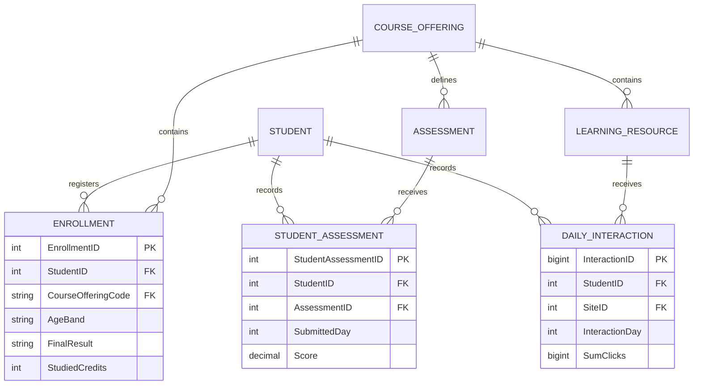
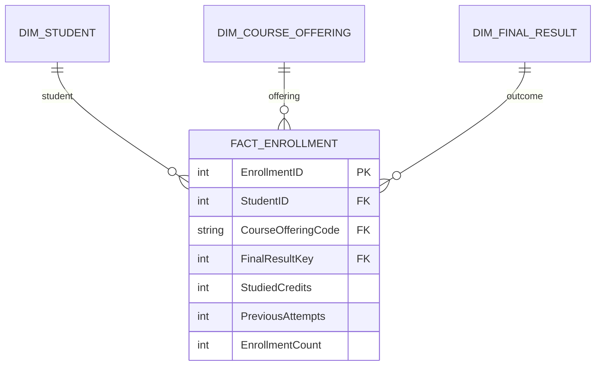
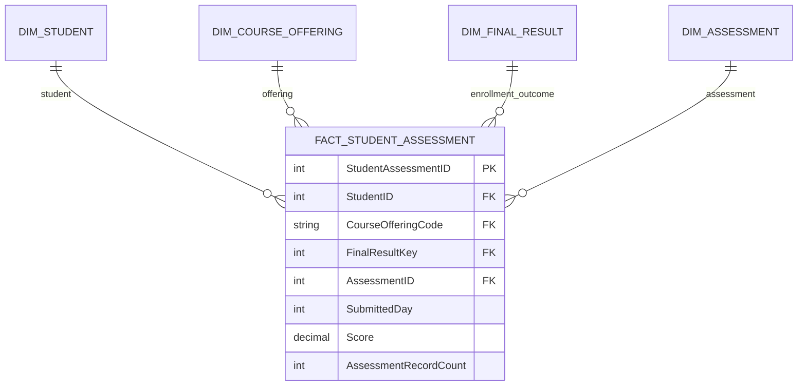
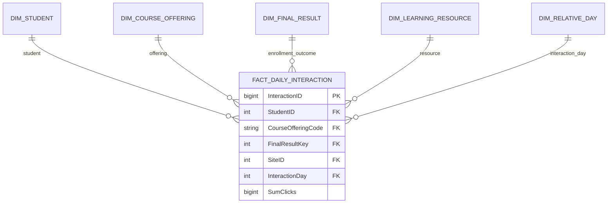

# Data Dictionary — OULAD Analytics Pipeline

**Project:** OULAD — Student Outcomes, Assessment Completion and Learning Engagement  
**Source files:** `courses.csv`, `assessments.csv`, `vle.csv`, `studentInfo.csv`, `studentRegistration.csv`, `studentAssessment.csv`, `studentVle.csv`  
**Implementation:** Microsoft SQL Server (T-SQL), Python/pandas; recommended Power BI semantic model  
**Documentation date:** 28 October 2026

This dictionary documents the supplied implementation from imported source tables through staging, cleaning, normalized ODS and the dimensional warehouse. It defines columns, types, nullability, keys, transformations, analytical features, eligibility rules and semantic relationships. Its structure follows the supplied HR Analytics Data Dictionary, adapted to OULAD's three fact-table grains.

**Evidence scope:** SQL definitions establish the implemented schema and load rules. Saved outputs in `Final_OULAD_Analysis(6).ipynb` establish recorded warehouse counts and analytical validation results. Original CSV files, staging execution logs and a Power BI model were not supplied; their counts or completed configuration are not inferred from the warehouse.

---

## 0. Layer overview

| Layer | Schema / source | Purpose |
|---|---|---|
| Source | Seven CSV files initially imported into `dbo.*` | Original course, student, registration, assessment, submission, resource and interaction data. |
| Staging | Seven `stg.raw_*` tables | Text copies of initially imported values in source-column order. |
| Cleaning | Seven `stg.vw_clean_*` views | Text normalization, missing-marker handling, exact normalized-row deduplication and safe type conversion. |
| Core / ODS | Seven `ods.*` tables | Typed entities, source and surrogate keys, constraints and daily interaction aggregation. |
| Dimensional warehouse | Six dimensions and three `dw.*` facts | Separate enrollment, assessment-record and daily-interaction grains. |
| Analytical preparation | Python/pandas notebook | Validated joins, expected assessment opportunities, timing eligibility and enrollment-level summaries. |
| Semantic model | Recommended Power BI relationships | Shared dimensions, explicit enrollment denominators and eligibility-aware measures; not verified as an implemented dashboard. |

The ODS separates source entities; the DW exposes shared dimensions and three facts. Python constructs analytical populations that are not physical warehouse tables.

---

## 1. Source inventory

| Source file / imported table | Columns | Intended source grain | Source business key | Notes |
|---|---:|---|---|---|
| `courses.csv` / `dbo.courses` | 3 | One module presentation | `(code_module, code_presentation)` | Length is in days. |
| `assessments.csv` / `dbo.assessments` | 6 | One assessment | `id_assessment` | Due day and weight belong to the assessment catalog. |
| `vle.csv` / `dbo.vle` | 6 | One resource associated with a presentation | `id_site` in the implemented model | ODS diagnostics also inspect presentation/resource combinations. |
| `studentInfo.csv` / `dbo.studentInfo` | 12 | One student enrollment | `(id_student, code_module, code_presentation)` | Contains final outcome and enrollment attributes, not just a unique person profile. |
| `studentRegistration.csv` / `dbo.studentRegistration` | 5 | One student enrollment | `(id_student, code_module, code_presentation)` | Relative registration and unregistration days. |
| `studentAssessment.csv` / `dbo.studentAssessment` | 5 | One student–assessment record | `(id_student, id_assessment)` | Includes banked results. |
| `studentVle.csv` / `dbo.studentVle` | 6 | One source interaction row | Student + module + presentation + resource + day identifies the target aggregation grain | Do not assume raw uniqueness at that grain; cleaning and aggregation precede ODS uniqueness. |

**Source row counts:** not independently verified for these uploaded materials. Warehouse counts below are not substituted for raw CSV counts.

### 1.1 Verified warehouse and analysis profile

| Recorded check | Result |
|---|---:|
| Warehouse tables discovered | 9 |
| Inspected key combinations passing checks | 14 of 14 |
| Declared foreign-key relationships passing checks | 12 of 12 |
| Null keys / orphan rows in checked warehouse foreign keys | 0 / 0 |
| Enrollment rows before and after each dimension merge | 32,593 / 32,593 |
| Unmatched rows in each enrollment dimension merge | 0 |
| Distinct students | 28,785 |
| Module presentations / modules | 22 / 7 |
| Warehouse assessment records | 173,912 |
| Warehouse daily interaction rows | 8,459,320 |
| Enrollments with / without interaction records | 29,228 / 3,365 |
| Unknown or missing enrollment outcomes | 0 |
| Missing registration days | 45 |
| Withdrawals with unknown unregistration day | 93 |

These are recorded results, not fresh SQL Server execution results. Key integrity does not imply that every nullable descriptive field is complete.

---

## 2. Staging and cleaning layer

### 2.1 Raw staging tables and columns

All raw staging fields are **`NVARCHAR(255) NULL`**. No primary or foreign keys are declared on the raw tables. The business keys are carried as source text; they are not enforced at this layer.

| Raw table | Columns in source order |
|---|---|
| `stg.raw_courses` | `code_module`, `code_presentation`, `module_presentation_length` |
| `stg.raw_assessments` | `code_module`, `code_presentation`, `id_assessment`, `assessment_type`, `date`, `weight` |
| `stg.raw_vle` | `id_site`, `code_module`, `code_presentation`, `activity_type`, `week_from`, `week_to` |
| `stg.raw_studentInfo` | `code_module`, `code_presentation`, `id_student`, `gender`, `region`, `highest_education`, `imd_band`, `age_band`, `num_of_prev_attempts`, `studied_credits`, `disability`, `final_result` |
| `stg.raw_studentRegistration` | `code_module`, `code_presentation`, `id_student`, `date_registration`, `date_unregistration` |
| `stg.raw_studentAssessment` | `id_assessment`, `id_student`, `date_submitted`, `is_banked`, `score` |
| `stg.raw_studentVle` | `code_module`, `code_presentation`, `id_student`, `id_site`, `date`, `sum_click` |

The staging script uses `INSERT INTO stg.raw_* SELECT * FROM dbo.*`. It therefore depends on matching source column order. It also contains `DROP TABLE dbo.*` statements after copying. Those statements remove the initially imported source tables; they are part of the supplied script, not a general requirement of staging. No staging deduplication or rerun-safe upsert is implemented, and no new execution was performed for this dictionary.

### 2.2 Common cleaning sequence

1. Apply `UPPER(TRIM(...))` to source text.
2. Map empty strings, `?`, `NULL` and `N/A` to SQL NULL.
3. Use `ROW_NUMBER()` partitioned by **all normalized source columns**, with `ORDER BY (SELECT NULL)`, and retain `rn = 1`.
4. Apply `TRY_CAST` to numeric fields.
5. Apply the explicit field-level range rules below.

**Important:** these views remove exact duplicates after text normalization. They do not choose an authoritative record among conflicting rows sharing the same business key. Conflicting variants survive and can fail downstream key constraints. Deduplication also precedes numeric conversion; text variants such as `01` and `1` can converge to the same typed value later.

### 2.3 Cleaning views and typed outputs

| View | Main conversion / validity rules |
|---|---|
| `stg.vw_clean_courses` | Presentation length → INT; retain only positive values, otherwise NULL. Module and presentation remain normalized text. |
| `stg.vw_clean_assessments` | Assessment ID → positive INT; due day → INT without an absolute-date conversion; weight → DECIMAL(6,2), retaining 0–100. |
| `stg.vw_clean_vle` | Resource ID → positive INT; WeekFrom and WeekTo → INT; activity type remains normalized text. |
| `stg.vw_clean_studentInfo` | Student ID → positive INT; previous attempts and studied credits → nonnegative INT; other descriptors and outcome remain normalized text. |
| `stg.vw_clean_studentRegistration` | Student ID → positive INT; registration and unregistration days → INT; negative days are retained. |
| `stg.vw_clean_studentAssessment` | Student/assessment IDs → positive INT; submitted day → INT; is_banked → INT restricted to 0/1; score → DECIMAL(6,2) restricted to 0–100. ODS casts is_banked into BIT. |
| `stg.vw_clean_studentVle` | Student/resource IDs → positive INT; interaction day → INT; sum_click → nonnegative BIGINT. |

The views do not enforce every category or chronology rule. For example, gender, disability, assessment type and final-result domain checks are applied in ODS; registration/submission chronology and assessment eligibility are reviewed in the notebook. Failed numeric conversion or an out-of-range numeric value generally becomes NULL, which may be accepted in a nullable target or rejected by a required key/measure column.

### 2.4 Relative-day rules

| Source field | Typed field | Meaning |
|---|---|---|
| `assessments.date` | `AssessmentDay` | Scheduled assessment due day relative to course start. |
| `studentRegistration.date_registration` | `RegistrationDay` | Relative enrollment registration day. |
| `studentRegistration.date_unregistration` | `UnregistrationDay` | Relative unregistration day. |
| `studentAssessment.date_submitted` | `SubmittedDay` | Relative recorded submission day. |
| `studentVle.date` | `InteractionDay` | Relative interaction day. |

These values are **signed integer offsets, not calendar dates**. Day 0 is course start; negative days precede it. The SQL does not construct actual calendar dates from presentation codes. Missing due days are not imputed; the notebook excludes uncertain timing from analyses requiring known deadlines.

---

## 3. Core / ODS layer — table and column reference

The following types and nullability reflect the supplied DDL. Identity columns that are primary keys are nonnullable. SQL CHECK constraints on nullable fields do not by themselves prohibit NULL.

### 3.1 `ods.Student`

**Grain:** One student.  
**Primary key:** `StudentID`.  
One stable profile per source student; five descriptive attributes are stored with the identifier.

| Column | SQL type | Nullable | Key / role | Definition |
|---|---|---|---|---|
| `StudentID` | `INT` | No | PK | Original source `id_student`; identifies a person across enrollments. |
| `Gender` | `NVARCHAR(1)` | Yes | Attribute / measure | Student gender category; source values are normalized to uppercase. |
| `Region` | `NVARCHAR(50)` | Yes | Attribute / measure | Student region; a descriptive category, not a geographic population count. |
| `HighestEducation` | `NVARCHAR(50)` | Yes | Attribute / measure | Highest prior educational qualification recorded for the student. |
| `IMDBand` | `NVARCHAR(50)` | Yes | Attribute / measure | Index of Multiple Deprivation band. Lower bands indicate greater deprivation; missing remains missing. |
| `Disability` | `NVARCHAR(1)` | Yes | Attribute / measure | Recorded disability indicator: Y or N; NULL means unavailable. |

### 3.2 `ods.CourseOffering`

**Grain:** One module × presentation.  
**Primary key:** `CourseOfferingCode`.  
Additional unique key: `(ModuleCode, PresentationCode)`.

| Column | SQL type | Nullable | Key / role | Definition |
|---|---|---|---|---|
| `CourseOfferingCode` | `NVARCHAR(8)` | No | PK | Derived identifier: `LEFT(code_module, 1) + code_presentation`, e.g. `A2013J` for AAA/2013J. |
| `ModuleCode` | `NVARCHAR(3)` | No | Attribute / measure | Original anonymized module code, e.g. AAA, BBB or CCC. |
| `PresentationCode` | `NVARCHAR(5)` | No | Attribute / measure | Original presentation code, e.g. 2013J or 2014B. |
| `PresentationLengthDays` | `INT` | No | Attribute / measure | Length of the module presentation in days; must be positive. |

### 3.3 `ods.Enrollment`

**Grain:** One student × course offering.  
**Primary key:** `EnrollmentID`.  
Additional unique key: `(StudentID, CourseOfferingCode)`.

| Column | SQL type | Nullable | Key / role | Definition |
|---|---|---|---|---|
| `EnrollmentID` | `INT IDENTITY(1,1)` | No | PK | Surrogate identifier for one student enrollment in a course offering. |
| `StudentID` | `INT` | No | FK → `ods.Student[StudentID]` | Original source `id_student`; identifies a person across enrollments. |
| `CourseOfferingCode` | `NVARCHAR(8)` | No | FK → `ods.CourseOffering[CourseOfferingCode]` | Derived identifier: `LEFT(code_module, 1) + code_presentation`, e.g. `A2013J` for AAA/2013J. |
| `AgeBand` | `NVARCHAR(255)` | Yes | Attribute / measure | Source age band recorded at enrollment; retained here because it may differ across enrollments. |
| `PreviousAttempts` | `INT` | Yes | Attribute / measure | Number of previous attempts at the same module; nonnegative when present. |
| `StudiedCredits` | `INT` | Yes | Attribute / measure | Total credits studied by the student at enrollment; not just the credit value of this one module. |
| `FinalResult` | `NVARCHAR(20)` | Yes | Attribute / measure | Final enrollment outcome; PASS, DISTINCTION, FAIL or WITHDRAWN. ODS permits NULL. |
| `RegistrationDay` | `INT` | Yes | Attribute / measure | Registration day relative to course start. Negative values mean registration before teaching starts. |
| `UnregistrationDay` | `INT` | Yes | Attribute / measure | Unregistration day relative to course start. NULL alone is not proof of successful completion. |

### 3.4 `ods.Assessment`

**Grain:** One source assessment.  
**Primary key:** `AssessmentID`.  
Each assessment belongs to one course offering.

| Column | SQL type | Nullable | Key / role | Definition |
|---|---|---|---|---|
| `AssessmentID` | `INT` | No | PK | Original source assessment identifier; identifies an assessment within its module presentation. |
| `CourseOfferingCode` | `NVARCHAR(8)` | No | FK → `ods.CourseOffering[CourseOfferingCode]` | Derived identifier: `LEFT(code_module, 1) + code_presentation`, e.g. `A2013J` for AAA/2013J. |
| `AssessmentType` | `NVARCHAR(10)` | Yes | Attribute / measure | Assessment category: TMA, CMA or EXAM in the ODS controlled values. |
| `AssessmentDay` | `INT` | Yes | Attribute / measure | Assessment due day relative to course start. NULL is retained when unavailable. |
| `Weight` | `DECIMAL(6,2)` | Yes | Attribute / measure | Assessment weight on a 0–100 scale; not a fraction on a 0–1 scale. |

### 3.5 `ods.StudentAssessment`

**Grain:** One student × assessment.  
**Primary key:** `StudentAssessmentID`.  
Additional unique key: `(StudentID, AssessmentID)`.

| Column | SQL type | Nullable | Key / role | Definition |
|---|---|---|---|---|
| `StudentAssessmentID` | `INT IDENTITY(1,1)` | No | PK | Surrogate identifier for a student–assessment record. |
| `StudentID` | `INT` | No | FK → `ods.Student[StudentID]` | Original source `id_student`; identifies a person across enrollments. |
| `AssessmentID` | `INT` | No | FK → `ods.Assessment[AssessmentID]` | Original source assessment identifier; identifies an assessment within its module presentation. |
| `SubmittedDay` | `INT` | Yes | Attribute / measure | Recorded submission day relative to course start; banked records require separate interpretation. |
| `IsBanked` | `BIT` | Yes | Attribute / measure | 1 = result carried forward from a previous presentation; 0 = current record; NULL = unknown. |
| `Score` | `DECIMAL(6,2)` | Yes | Attribute / measure | Recorded assessment score on a 0–100 scale. A missing score is not replaced by zero. |

### 3.6 `ods.LearningResource`

**Grain:** One source learning resource.  
**Primary key:** `SiteID`.  
Each resource belongs to one course offering.

| Column | SQL type | Nullable | Key / role | Definition |
|---|---|---|---|---|
| `SiteID` | `INT` | No | PK | Original learning-resource identifier from `id_site`; globally unique in the implemented model. |
| `CourseOfferingCode` | `NVARCHAR(8)` | No | FK → `ods.CourseOffering[CourseOfferingCode]` | Derived identifier: `LEFT(code_module, 1) + code_presentation`, e.g. `A2013J` for AAA/2013J. |
| `ActivityType` | `NVARCHAR(255)` | Yes | Attribute / measure | Normalized learning activity category, e.g. OUCONTENT, FORUMNG, HOMEPAGE or QUIZ. |
| `WeekFrom` | `INT` | Yes | Attribute / measure | Source planned resource availability start week; may be missing. |
| `WeekTo` | `INT` | Yes | Attribute / measure | Source planned resource availability end week; may be missing. |

### 3.7 `ods.StudentDailyInteraction`

**Grain:** One student × resource × relative day.  
**Primary key:** `InteractionID`.  
Additional unique key: `(StudentID, SiteID, InteractionDay)`.

| Column | SQL type | Nullable | Key / role | Definition |
|---|---|---|---|---|
| `InteractionID` | `BIGINT IDENTITY(1,1)` | No | PK | Surrogate identifier for a student–resource–relative-day interaction row. |
| `StudentID` | `INT` | No | FK → `ods.Student[StudentID]` | Original source `id_student`; identifies a person across enrollments. |
| `SiteID` | `INT` | No | FK → `ods.LearningResource[SiteID]` | Original learning-resource identifier from `id_site`; globally unique in the implemented model. |
| `InteractionDay` | `INT` | No | Attribute / measure | Recorded interaction day relative to course start; negative values are retained. |
| `SumClicks` | `BIGINT` | No | Attribute / measure | Sum of retained cleaned click values at student–resource–day grain; nonnegative. |

### 3.8 Source-to-target mapping

| Source | Source fields → ODS target fields | Transformation |
|---|---|---|
| `courses` | `code_module` → `CourseOffering.ModuleCode`; `code_presentation` → `PresentationCode`; `module_presentation_length` → `PresentationLengthDays` | Derive `CourseOfferingCode` from the module's first character and the presentation. |
| `studentInfo` | `id_student`, `gender`, `region`, `highest_education`, `imd_band`, `disability` → `Student.StudentID`, `Gender`, `Region`, `HighestEducation`, `IMDBand`, `Disability` | SELECT DISTINCT stable student profiles. |
| `studentInfo` | `age_band`, `num_of_prev_attempts`, `studied_credits`, `final_result` → `Enrollment.AgeBand`, `PreviousAttempts`, `StudiedCredits`, `FinalResult` | Resolve student and course-offering keys; preserve enrollment grain. |
| `studentRegistration` | `date_registration`, `date_unregistration` → `Enrollment.RegistrationDay`, `UnregistrationDay` | Match to studentInfo using student + module + presentation. |
| `assessments` | `id_assessment`, `assessment_type`, `date`, `weight` → `Assessment.AssessmentID`, `AssessmentType`, `AssessmentDay`, `Weight` | Resolve offering using module + presentation. |
| `studentAssessment` | `id_student`, `id_assessment`, `date_submitted`, `is_banked`, `score` → `StudentAssessment.StudentID`, `AssessmentID`, `SubmittedDay`, `IsBanked`, `Score` | Resolve an enrollment in the assessment's offering; generate StudentAssessmentID. |
| `vle` | `id_site`, `activity_type`, `week_from`, `week_to` → `LearningResource.SiteID`, `ActivityType`, `WeekFrom`, `WeekTo` | Resolve offering using module + presentation. |
| `studentVle` | `id_student`, `id_site`, `date`, `sum_click` → `StudentDailyInteraction.StudentID`, `SiteID`, `InteractionDay`, `SumClicks` | SUM retained cleaned click rows by module + presentation + student + resource + day; match enrollment/resource; generate InteractionID. |

`EnrollmentID`, `StudentAssessmentID` and `InteractionID` are generated by ODS IDENTITY columns. Their values are carried into the warehouse; they are not regenerated there.

### 3.9 Declared CHECK constraints and enforcement scope

| Location | Constraint domain |
|---|---|
| `ods.Student` | Gender in M/F; Disability in Y/N. |
| `ods.CourseOffering` and `dw.DimCourseOffering` | Offering code equals first module character + presentation; length > 0. |
| `ods.Enrollment` | PreviousAttempts ≥ 0; StudiedCredits ≥ 0; FinalResult in PASS/FAIL/WITHDRAWN/DISTINCTION. |
| `ods.Assessment` | AssessmentType in TMA/CMA/EXAM; Weight between 0 and 100. |
| `ods.StudentAssessment` | Score between 0 and 100. |
| `ods.StudentDailyInteraction` | SumClicks ≥ 0. |
| `dw.DimAssessment` | Weight between 0 and 100. |
| `dw.FactEnrollment` | EnrollmentCount = 1; PreviousAttempts ≥ 0; StudiedCredits ≥ 0. |
| `dw.FactStudentAssessment` | AssessmentRecordCount = 1; Score between 0 and 100. |
| `dw.FactDailyInteraction` | SumClicks ≥ 0. |

These are the explicit DDL CHECK domains. The warehouse does not repeat every ODS category check. BIT constrains non-NULL banked values to the stored Boolean domain, and cleaning explicitly maps invalid source banked indicators to NULL before BIT storage. No CHECK constraint establishes registration/submission chronology, resource week ordering or analytical eligibility; those require separate validation.

---

## 4. Normalization rules applied

### 4.1 First Normal Form (1NF)

Fields contain atomic values. Enrollments, assessment records and daily interactions are represented by separate rows at explicit grains. Raw values remain in staging, while cleaning views expose transformed values.

### 4.2 Second Normal Form (2NF)

Composite business grains are protected even where a surrogate primary key exists:

| Entity | Protected business grain |
|---|---|
| CourseOffering | ModuleCode + PresentationCode |
| Enrollment | StudentID + CourseOfferingCode |
| StudentAssessment | StudentID + AssessmentID |
| StudentDailyInteraction | StudentID + SiteID + InteractionDay |

Student profile descriptors are separated from enrollment-specific values. Assessment descriptions and resource descriptions are separated from student behavior records. A single surrogate key does not by itself establish normalization; the business dependencies remain relevant.

### 4.3 Third Normal Form (3NF) intent and implementation boundary

| Dependency separated | ODS design |
|---|---|
| Student → stable profile | `Student` |
| Module presentation → presentation length | `CourseOffering` |
| Student + offering → outcome, load, attempts and age band | `Enrollment` |
| Assessment → offering, type, due day and weight | `Assessment` |
| Resource → offering and activity descriptors | `LearningResource` |
| Student + assessment → recorded submission and score | `StudentAssessment` |
| Student + resource + day → clicks | `StudentDailyInteraction` |

This is the implemented normalized ODS structure, not a claim that every possible dependency has been formally removed. `CourseOfferingCode` is derived while its component codes are retained. The one-profile-per-student design also assumes the five stored descriptive attributes are consistent across that student's enrollments. The script includes profile diagnostics, including a comparison without age band; separate saved results for those diagnostics were not supplied.

The compact offering code is collision-free for the current AAA–GGG module set because their first characters differ. New modules sharing the same first character would require a revised code rule; the current encoding is not universally safe for arbitrary module names.

### 4.4 Load-protection and integrity rules

- ODS DDL is wrapped in a transaction. Individual entity loads use their own transactions and stop if the corresponding target is nonempty; this is an initial-build approach, not an incremental upsert.
- StudentInfo and studentRegistration key sets are compared in both directions with EXCEPT before loading enrollments.
- Required identifiers and foreign keys reject unresolved source links. ODS submission/interaction loads explicitly resolve the enrollment in the correct offering; an unresolved match becomes a required-key failure.
- Declared ODS foreign keys are student/offering, student/assessment and student/resource links. There is **no physical EnrollmentID foreign key** in StudentAssessment or StudentDailyInteraction; matching to enrollment is a load-validation rule.
- The DW script creates tables within one transaction and validates matching enrollments for submissions/interactions before loading facts. Existing tables cause CREATE TABLE to fail; optional DROP statements are commented out. There is no separate incremental merge.
- Inserted fact counts and final fact/dimension counts are compared with ODS. Total clicks are also reconciled from ODS to DW before commit.
- Structural errors trigger rollback and THROW. Script controls are distinguished from separately evidenced execution outcomes.

---

## 5. ODS entity-relationship model

The diagram shows declared foreign keys. The enrollment-matching load checks for submissions/interactions are described in Section 4.4 rather than shown as nonexistent physical relationships.

---

## 6. Star schema — `dw.*` dimensional model

The warehouse is a **fact constellation with shared dimensions**: enrollment outcomes, assessment records and daily interactions have different grains. It is not a single flat fact table.

| Table | Type | Grain | Recorded rows |
|---|---|---|---:|
| `dw.DimStudent` | Dimension | One student | 28,785 |
| `dw.DimCourseOffering` | Dimension | One module presentation | 22 |
| `dw.DimFinalResult` | Dimension | One outcome member | 5 |
| `dw.DimAssessment` | Dimension | One assessment | 206 |
| `dw.DimLearningResource` | Dimension | One resource | 6,364 |
| `dw.DimRelativeDay` | Dimension | One signed relative day | 974 |
| `dw.FactEnrollment` | Fact | One student × offering | 32,593 |
| `dw.FactStudentAssessment` | Fact | One student × assessment | 173,912 |
| `dw.FactDailyInteraction` | Fact | One student × resource × day | 8,459,320 |

### 6.1 `dw.DimStudent`

**Grain:** One student.  
**Primary key:** `StudentID`.  
Copied from ODS; no new student surrogate key is generated.

**Recorded warehouse rows:** 28,785.

| Column | SQL type | Nullable | Key / role | Definition |
|---|---|---|---|---|
| `StudentID` | `INT` | No | PK | Original source `id_student`; identifies a person across enrollments. |
| `Gender` | `NVARCHAR(1)` | Yes | Attribute / measure | Student gender category; source values are normalized to uppercase. |
| `Region` | `NVARCHAR(50)` | Yes | Attribute / measure | Student region; a descriptive category, not a geographic population count. |
| `HighestEducation` | `NVARCHAR(50)` | Yes | Attribute / measure | Highest prior educational qualification recorded for the student. |
| `IMDBand` | `NVARCHAR(50)` | Yes | Attribute / measure | Index of Multiple Deprivation band. Lower bands indicate greater deprivation; missing remains missing. |
| `Disability` | `NVARCHAR(1)` | Yes | Attribute / measure | Recorded disability indicator: Y or N; NULL means unavailable. |

### 6.2 `dw.DimCourseOffering`

**Grain:** One module × presentation.  
**Primary key:** `CourseOfferingCode`.  
Adds presentation year and term to the ODS offering attributes.

**Recorded warehouse rows:** 22.

| Column | SQL type | Nullable | Key / role | Definition |
|---|---|---|---|---|
| `CourseOfferingCode` | `NVARCHAR(8)` | No | PK | Derived identifier: `LEFT(code_module, 1) + code_presentation`, e.g. `A2013J` for AAA/2013J. |
| `ModuleCode` | `NVARCHAR(3)` | No | Attribute / measure | Original anonymized module code, e.g. AAA, BBB or CCC. |
| `PresentationCode` | `NVARCHAR(5)` | No | Attribute / measure | Original presentation code, e.g. 2013J or 2014B. |
| `PresentationLengthDays` | `INT` | No | Attribute / measure | Length of the module presentation in days; must be positive. |
| `PresentationYear` | `INT` | Yes | Attribute / measure | `TRY_CONVERT(INT, LEFT(PresentationCode, 4))`; year parsed from the presentation code. |
| `PresentationTerm` | `NVARCHAR(1)` | No | Attribute / measure | `RIGHT(PresentationCode, 1)`; term label, such as B or J. |

### 6.3 `dw.DimFinalResult`

**Grain:** One outcome classification.  
**Primary key:** `FinalResultKey`.  
Five fixed members, including UNKNOWN; `FinalResult` is unique.

**Recorded warehouse rows:** 5.

| Column | SQL type | Nullable | Key / role | Definition |
|---|---|---|---|---|
| `FinalResultKey` | `INT` | No | PK | Outcome lookup key; mapped from the enrollment outcome, with NULL mapped to UNKNOWN. |
| `FinalResult` | `NVARCHAR(20)` | No | UK | Controlled outcome label, including the explicit UNKNOWN member. |
| `IsSuccess` | `BIT` | No | Attribute / measure | 1 for PASS or DISTINCTION; 0 for other lookup members, including UNKNOWN. |
| `IsWithdrawn` | `BIT` | No | Attribute / measure | 1 for WITHDRAWN; 0 for other lookup members, including UNKNOWN. |

### 6.4 `dw.DimAssessment`

**Grain:** One assessment.  
**Primary key:** `AssessmentID`.  
Offering context is omitted from this dimension; retained in ODS and the assessment fact.

**Recorded warehouse rows:** 206.

| Column | SQL type | Nullable | Key / role | Definition |
|---|---|---|---|---|
| `AssessmentID` | `INT` | No | PK | Original source assessment identifier; identifies an assessment within its module presentation. |
| `AssessmentType` | `NVARCHAR(10)` | Yes | Attribute / measure | Assessment category: TMA, CMA or EXAM in the ODS controlled values. |
| `AssessmentDay` | `INT` | Yes | Attribute / measure | Assessment due day relative to course start. NULL is retained when unavailable. |
| `Weight` | `DECIMAL(6,2)` | Yes | Attribute / measure | Assessment weight on a 0–100 scale; not a fraction on a 0–1 scale. |

### 6.5 `dw.DimLearningResource`

**Grain:** One resource.  
**Primary key:** `SiteID`.  
Offering context is omitted from this dimension; retained in ODS and the interaction fact.

**Recorded warehouse rows:** 6,364.

| Column | SQL type | Nullable | Key / role | Definition |
|---|---|---|---|---|
| `SiteID` | `INT` | No | PK | Original learning-resource identifier from `id_site`; globally unique in the implemented model. |
| `ActivityType` | `NVARCHAR(255)` | Yes | Attribute / measure | Normalized learning activity category, e.g. OUCONTENT, FORUMNG, HOMEPAGE or QUIZ. |
| `WeekFrom` | `INT` | Yes | Attribute / measure | Source planned resource availability start week; may be missing. |
| `WeekTo` | `INT` | Yes | Attribute / measure | Source planned resource availability end week; may be missing. |

### 6.6 `dw.DimRelativeDay`

**Grain:** One relative day.  
**Primary key:** `RelativeDay`.  
Continuous integer range covering observed ODS day bounds and day 0.

**Recorded warehouse rows:** 974.

| Column | SQL type | Nullable | Key / role | Definition |
|---|---|---|---|---|
| `RelativeDay` | `INT` | No | PK | Signed integer day offset from course start; this is not a calendar-date key. |
| `StudyWeekNumber` | `INT` | Yes | Attribute / measure | For nonnegative days, integer `RelativeDay / 7 + 1`; negative days have NULL. |
| `DayPhase` | `NVARCHAR(20)` | No | Attribute / measure | Before start for negative days, Start day for day 0, and After start for positive days. |
| `IsBeforeStart` | `BIT` | No | Attribute / measure | 1 for a negative relative day; otherwise 0. |

### 6.7 `dw.FactEnrollment`

**Grain:** One student × course offering.  
**Primary key:** `EnrollmentID`.  
Additional unique key: `(StudentID, CourseOfferingCode)`.

**Recorded warehouse rows:** 32,593.

| Column | SQL type | Nullable | Key / role | Definition |
|---|---|---|---|---|
| `EnrollmentID` | `INT` | No | PK | Surrogate identifier for one student enrollment in a course offering. Copied from ODS; the DW column is not IDENTITY. |
| `StudentID` | `INT` | No | FK → `dw.DimStudent[StudentID]` | Original source `id_student`; identifies a person across enrollments. |
| `CourseOfferingCode` | `NVARCHAR(8)` | No | FK → `dw.DimCourseOffering[CourseOfferingCode]` | Derived identifier: `LEFT(code_module, 1) + code_presentation`, e.g. `A2013J` for AAA/2013J. |
| `AgeBand` | `NVARCHAR(255)` | Yes | Attribute / measure | Source age band recorded at enrollment; retained here because it may differ across enrollments. |
| `FinalResultKey` | `INT` | No | FK → `dw.DimFinalResult[FinalResultKey]` | Outcome lookup key; mapped from the enrollment outcome, with NULL mapped to UNKNOWN. It describes the enrollment outcome, not a separate assessment or interaction result. |
| `PreviousAttempts` | `INT` | Yes | Attribute / measure | Number of previous attempts at the same module; nonnegative when present. |
| `StudiedCredits` | `INT` | Yes | Attribute / measure | Total credits studied by the student at enrollment; not just the credit value of this one module. |
| `RegistrationDay` | `INT` | Yes | Attribute / measure | Registration day relative to course start. Negative values mean registration before teaching starts. |
| `UnregistrationDay` | `INT` | Yes | Attribute / measure | Unregistration day relative to course start. NULL alone is not proof of successful completion. |
| `EnrollmentCount` | `INT` | No | Attribute / measure | Additive enrollment counter, constrained to 1 per fact row. |

### 6.8 `dw.FactStudentAssessment`

**Grain:** One student × assessment.  
**Primary key:** `StudentAssessmentID`.  
Additional unique key: `(StudentID, AssessmentID)`; includes banked records.

**Recorded warehouse rows:** 173,912.

| Column | SQL type | Nullable | Key / role | Definition |
|---|---|---|---|---|
| `StudentAssessmentID` | `INT` | No | PK | Surrogate identifier for a student–assessment record. Copied from ODS; the DW column is not IDENTITY. |
| `StudentID` | `INT` | No | FK → `dw.DimStudent[StudentID]` | Original source `id_student`; identifies a person across enrollments. |
| `CourseOfferingCode` | `NVARCHAR(8)` | No | FK → `dw.DimCourseOffering[CourseOfferingCode]` | Derived identifier: `LEFT(code_module, 1) + code_presentation`, e.g. `A2013J` for AAA/2013J. |
| `FinalResultKey` | `INT` | No | FK → `dw.DimFinalResult[FinalResultKey]` | Outcome lookup key; mapped from the enrollment outcome, with NULL mapped to UNKNOWN. It describes the enrollment outcome, not a separate assessment or interaction result. |
| `AssessmentID` | `INT` | No | FK → `dw.DimAssessment[AssessmentID]` | Original source assessment identifier; identifies an assessment within its module presentation. |
| `SubmittedDay` | `INT` | Yes | Attribute / measure | Recorded submission day relative to course start; banked records require separate interpretation. |
| `IsBanked` | `BIT` | Yes | Attribute / measure | 1 = result carried forward from a previous presentation; 0 = current record; NULL = unknown. |
| `Score` | `DECIMAL(6,2)` | Yes | Attribute / measure | Recorded assessment score on a 0–100 scale. A missing score is not replaced by zero. |
| `AssessmentRecordCount` | `INT` | No | Attribute / measure | Additive record counter, constrained to 1; includes banked records and is not an expected-assessment denominator. |

### 6.9 `dw.FactDailyInteraction`

**Grain:** One student × resource × relative day.  
**Primary key:** `InteractionID`.  
Additional unique key: `(StudentID, SiteID, InteractionDay)`; offering follows resource ownership.

**Recorded warehouse rows:** 8,459,320.

| Column | SQL type | Nullable | Key / role | Definition |
|---|---|---|---|---|
| `InteractionID` | `BIGINT` | No | PK | Surrogate identifier for a student–resource–relative-day interaction row. Copied from ODS; the DW column is not IDENTITY. |
| `StudentID` | `INT` | No | FK → `dw.DimStudent[StudentID]` | Original source `id_student`; identifies a person across enrollments. |
| `CourseOfferingCode` | `NVARCHAR(8)` | No | FK → `dw.DimCourseOffering[CourseOfferingCode]` | Derived identifier: `LEFT(code_module, 1) + code_presentation`, e.g. `A2013J` for AAA/2013J. |
| `FinalResultKey` | `INT` | No | FK → `dw.DimFinalResult[FinalResultKey]` | Outcome lookup key; mapped from the enrollment outcome, with NULL mapped to UNKNOWN. It describes the enrollment outcome, not a separate assessment or interaction result. |
| `SiteID` | `INT` | No | FK → `dw.DimLearningResource[SiteID]` | Original learning-resource identifier from `id_site`; globally unique in the implemented model. |
| `InteractionDay` | `INT` | No | FK → `dw.DimRelativeDay[RelativeDay]` | Recorded interaction day relative to course start; negative values are retained. |
| `SumClicks` | `BIGINT` | No | Attribute / measure | Sum of retained cleaned click values at student–resource–day grain; nonnegative. |

### 6.10 Outcome lookup members

| FinalResultKey | FinalResult | IsSuccess | IsWithdrawn |
|---:|---|---:|---:|
| 0 | UNKNOWN | 0 | 0 |
| 1 | PASS | 1 | 0 |
| 2 | DISTINCTION | 1 | 0 |
| 3 | FAIL | 0 | 0 |
| 4 | WITHDRAWN | 0 | 1 |

An UNKNOWN member is not a failed or non-withdrawn student outcome merely because both flags are zero. Classify it explicitly and apply the appropriate known-outcome denominator. No enrollment uses UNKNOWN in the saved analysis.

### 6.11 Dimensional enrichment and omitted context

- `DimStudent` copies the five ODS profile attributes; age band remains in FactEnrollment.
- `DimCourseOffering` adds parsed year and term. `CourseOfferingCode` is copied without a new surrogate.
- `FinalResultKey` is added to all three facts from the matched enrollment. It is a retrospective outcome classification, not a separate result of an interaction or assessment.
- `DimAssessment` does **not** contain CourseOfferingCode. The notebook joins it back to `ods.Assessment` to recover the offering when constructing the expected-assessment catalog.
- `DimLearningResource` likewise omits CourseOfferingCode; resource ownership remains in `ods.LearningResource` and appears in observed interaction facts.
- Expected assessment opportunities cannot be reconstructed reliably from observed submission rows alone: students with missing records must still receive eligible expected rows. An ODS-backed catalog or an explicitly prepared equivalent is required.
- `DimRelativeDay` spans the minimum to maximum observed relative days across interactions, submissions, assessment deadlines, registration and unregistration, and includes day 0. Its 974 rows describe that generated range, not 974 calendar teaching days per course.

---

## 7. Star-schema ERDs

These diagrams show each fact with its declared dimension relationships. Shared dimension names refer to the same physical tables across the three diagrams.

### 7.1 Enrollment star

### 7.2 Assessment-record star

### 7.3 Daily-interaction star

---

## 8. Data-quality findings and resolution rules

| Finding / risk | Recorded evidence or implementation behavior | Handling / interpretation |
|---|---|---|
| Key duplication or missing key values in DW | All 14 inspected key combinations passed | Preserve PK/UK constraints and check grain after every analytical join. |
| Null or unmatched declared DW foreign keys | All 12 checked relationships passed, with zero null/orphan rows | Validate links before loading and reconcile counts. |
| Exact normalized duplicates | All cleaning views contain full-row ROW_NUMBER deduplication | Does not resolve conflicting business-key records; removed-row counts were not supplied. |
| Invalid numeric values | Conversion/range rules yield NULL | Review required-key failures and nullable missing values; do not equate conversion success with complete data. |
| Missing registration day | 45 enrollments | Restrict timing-sensitive comparisons and retain exclusions explicitly. |
| Withdrawal without known unregistration day | 93 withdrawals | Report unknown timing separately; do not assign an arbitrary time band. |
| No interaction records | 3,365 enrollments | Keep coverage distinct from measured zero activity. |
| Full-window eligible enrollments without interaction records | 475 of 27,229 | Early engagement statistics use 26,754 measured enrollments; no-record cases are not automatically filled with zero. |
| No submission record among eligible current requirements | 49,214 of 214,627, or 22.93% | Confirm completeness before treating as a missed assessment; exclude banked requirements from this denominator. |
| Unusable timing among eligible current submissions | 3 of 165,413 | On-time/late analysis uses 165,410 usable records. |
| Missing regional IMD data | 40.1% in North Region; 22.5% in Ireland, as documented in the stakeholder report | Show missingness and limit comparisons. |
| One stable student profile | ODS SELECT DISTINCT and StudentID PK; profile diagnostics included in script | Conflicting profiles need investigation; saved diagnostic results were not supplied separately. |
| Interaction reduction from source | Full-row deduplication occurs before daily SUM; DW has 8,459,320 rows | Raw-to-clean reconciliation is needed to separate deduplication effects from aggregation. |
| ODS-to-DW completeness | Fact/dimension count and total-click checks are implemented | Separate saved reconciliation query results were not supplied; do not claim raw click preservation from these checks. |
| Offering-code collisions in future data | Code uses only the module's first character | Revisit the code-generation rule if future modules share a first character. |

### Valid business conditions and distinctions

- One student can enroll in multiple presentations; distinct student count differs from enrollment count.
- Negative relative days are valid pre-start events.
- A NULL unregistration day can be consistent with a non-withdrawn enrollment. A WITHDRAWN result with unknown day requires timing review.
- Banked records are valid carried-forward results and are not new current submissions.
- Missing assessment scores are not automatically zero scores or failures.
- No interaction record, a record with zero clicks and no positive activity during a selected window are different states.
- A missing assessment due day can be legitimate source incompleteness; it prevents deadline analysis and is not filled with a guessed date.
- Weight or score zero is within the implemented 0–100 domain. SQL allows zero credits, while the workload analysis uses positive-credit bands and records no missing/nonpositive credits in the saved output.

---

## 9. Business rules and analytical features

### 9.1 Warehouse features

| Feature | Definition / storage |
|---|---|
| CourseOfferingCode | First character of ModuleCode + PresentationCode; physical ODS and DW column. |
| PresentationYear / PresentationTerm | First four / last character of PresentationCode; physical DW attributes. |
| FinalResultKey | Fixed classification mapping; NULL ODS outcome maps to key 0, UNKNOWN. |
| IsSuccess | Outcome lookup flag for PASS or DISTINCTION. |
| IsWithdrawn | Outcome lookup flag for WITHDRAWN. |
| EnrollmentCount | Physical fact counter fixed at 1. |
| AssessmentRecordCount | Physical record counter fixed at 1, including banked records. |
| SumClicks | Physical daily resource click sum after cleaning and aggregation. |
| StudyWeekNumber | RelativeDay / 7 + 1 for nonnegative days; days 0–6 form week 1. |
| DayPhase / IsBeforeStart | Physical relative-day classification and pre-start flag. |

### 9.2 Notebook features — not additional DW columns

| Feature / dataset | Definition |
|---|---|
| WorkloadBand | 1–60 credits, 61–120 credits or above 120 credits; invalid/missing values are reviewed. |
| AttemptGroup | No previous attempts versus one or more previous attempts at the same module. |
| WithdrawalTiming | Before start; days 0–27; day 28 onward; unknown day. |
| expected_assessments | One enrollment × TMA/CMA assessment in the same offering; 286,898 candidate opportunities. |
| EligibilityStatus | Eligible; due before registration; withdrawn before due; uncertain timing/enrollment quality; or withdrawal on due day. |
| RecordStatus | Current submission, banked, no submission record or unknown banked status. |
| SubmissionDelayDays | SubmittedDay − AssessmentDay, used only where timing is considered usable. |
| SubmissionRatePct | Current submissions / eligible current requirements per enrollment, excluding banked requirements. |
| EligibilityDays0_27 | FULL_WINDOW, NOT_FULL_WINDOW, UNKNOWN or REVIEW_TIMING according to registration, continuation and course-length rules. |
| ClicksDays0_27 / ActiveDays0_27 | Recorded click sum / distinct positive-activity days during days 0–27. |
| WeeklyClicks / WeeklyActiveDays | Click sum / distinct positive-activity days in the eligible study week. |
| HighEngagement | Positive days 0–27 clicks at or above the course-offering median among enrollments included in the joint comparison. |
| SubmissionRateByDay27Pct | Eligible current requirements due during days 0–27 that were submitted by day 27 / eligible current requirements in that window. |
| HighSubmission | SubmissionRateByDay27Pct ≥ 80%. |
| JointGroup | High/High, High/Low, Low/High or Low/Low engagement/submission combination. |

For expected-assessment eligibility, registration must precede or coincide with the deadline, the deadline must fall within the valid presentation interval, and a withdrawn student's unregistration must be strictly after the due day. Withdrawal on the due day is uncertain. Other contradictory enrollment/timing states are also kept out of the eligible population.

Full-window early analysis requires registration by day 0, sufficient course length and evidence of continuation beyond day 27 without a flagged chronology conflict. Weekly analysis likewise requires availability throughout the full week. These rules exclude students who leave before the observation period ends.

The joint comparison additionally requires relevant early current assessment requirements and reliable submission timing. It includes **21,533 enrollments** in AAA, BBB, CCC, DDD and FFF; EEE/GGG are excluded. The 80% and median-based thresholds are exploratory analytical definitions, not validated operational alerts.

---

## 10. Power BI relationship design

### 10.1 Recommended relationships mirroring declared DW foreign keys

The following are **recommended**, active, one-to-many relationships with **single-direction filtering from dimension to fact**. A Power BI file was not supplied, so actual semantic-model configuration is not verified.

| One-side column | Many-side column | Cardinality | Direction | Proposed status |
|---|---|---|---|---|
| `DimStudent[StudentID]` | `FactEnrollment[StudentID]` | 1:* | Single | Active |
| `DimCourseOffering[CourseOfferingCode]` | `FactEnrollment[CourseOfferingCode]` | 1:* | Single | Active |
| `DimFinalResult[FinalResultKey]` | `FactEnrollment[FinalResultKey]` | 1:* | Single | Active |
| `DimStudent[StudentID]` | `FactStudentAssessment[StudentID]` | 1:* | Single | Active |
| `DimCourseOffering[CourseOfferingCode]` | `FactStudentAssessment[CourseOfferingCode]` | 1:* | Single | Active |
| `DimFinalResult[FinalResultKey]` | `FactStudentAssessment[FinalResultKey]` | 1:* | Single | Active |
| `DimAssessment[AssessmentID]` | `FactStudentAssessment[AssessmentID]` | 1:* | Single | Active |
| `DimStudent[StudentID]` | `FactDailyInteraction[StudentID]` | 1:* | Single | Active |
| `DimCourseOffering[CourseOfferingCode]` | `FactDailyInteraction[CourseOfferingCode]` | 1:* | Single | Active |
| `DimFinalResult[FinalResultKey]` | `FactDailyInteraction[FinalResultKey]` | 1:* | Single | Active |
| `DimLearningResource[SiteID]` | `FactDailyInteraction[SiteID]` | 1:* | Single | Active |
| `DimRelativeDay[RelativeDay]` | `FactDailyInteraction[InteractionDay]` | 1:* | Single | Active |

### 10.2 Relative-day roles and filter behavior

Only `DimRelativeDay[RelativeDay]` → `FactDailyInteraction[InteractionDay]` is declared as a relative-day FK in the supplied warehouse. There are no declared day FKs for registration, unregistration, submission or assessment due day.

If those roles are added in Power BI, use clearly named role-specific date-offset dimensions or inactive relationships with explicit measure activation. Adding shared active day paths through both an assessment dimension and an assessment fact can create ambiguous filtering; design each analytical role deliberately. A relative-day dimension is not an ordinary calendar Date table.

### 10.3 Cross-fact analysis and enrollment filters

- Calculate overall enrollment outcomes from FactEnrollment; counting rows in an interaction or assessment fact would measure recorded behavior rather than all enrollments.
- Shared student, offering and outcome dimensions filter the three facts independently. Do not create direct relationships between the detailed facts to combine them.
- Enrollment-level fields such as AgeBand, StudiedCredits and PreviousAttempts are stored in FactEnrollment. Under single-direction relationships, selecting them does not automatically filter the behavioral facts. Prepare an enrollment-grain analytical table/bridge with a unique key, or transfer selected enrollment keys explicitly in measures. Such additions are recommendations, not supplied physical DW objects.
- For engagement × submission, aggregate both sources to StudentID + CourseOfferingCode and join one-to-one after applying eligibility rules. A StudentID-only join mixes presentations; a detailed fact-to-fact join multiplies rows.
- Do not expect a resource or assessment dimension to filter total enrollment outcomes automatically. Define the intended eligible population before applying such a restriction.
- FinalResultKey supports retrospective outcome comparisons. Exclude final outcomes and future observations from inputs to any prospective early-support model.

### 10.4 Export / connection inventory

Connect to all nine `dw.*` objects for the basic semantic model. If exported, use the table name as the CSV basename, e.g. `DimStudent.csv`, `FactEnrollment.csv`, `FactStudentAssessment.csv` and `FactDailyInteraction.csv`. Exports are suggested filenames; no CSV exports were created for this documentation task.

Expected-opportunity measures also require the assessment-to-offering catalog and enrollment timing. In the supplied notebook, this comes from a join to `ods.Assessment`; it is not a tenth physical warehouse table. Any prepared semantic-model equivalent must preserve catalog rows even when no submission exists.

---

## 11. Core analytical KPIs

| KPI | Definition / denominator | Primary source / recorded value |
|---|---|---|
| Enrollments | COUNTROWS(FactEnrollment) or SUM(EnrollmentCount) | FactEnrollment; 32,593 |
| Distinct students | DISTINCTCOUNT of StudentID in the selected enrollment population | FactEnrollment; 28,785 overall |
| Successful enrollments | PASS + DISTINCTION | FactEnrollment + DimFinalResult; 15,385 |
| Success rate | Successful / known-outcome enrollments | 47.20% overall |
| Withdrawal rate | WITHDRAWN / known-outcome enrollments | 31.16%; 10,156 withdrawals |
| Failure rate | FAIL / known-outcome enrollments | 21.64%; 7,052 failures |
| Combined withdrawal and failure | (WITHDRAWN + FAIL) / known-outcome enrollments | 52.80%; 17,208 affected enrollments |
| Distinction rate | DISTINCTION / known-outcome enrollments | 9.28%; 3,024 enrollments |
| Share of withdrawals by period | Withdrawals in period / all withdrawals | Before start + days 0–27: 49.55% of 10,156 withdrawals |
| Assessment record count | SUM(AssessmentRecordCount) | FactStudentAssessment; 173,912; not completion rate |
| Missing submission-record share | No-record eligible opportunities / eligible current requirements, excluding banked | 49,214 / 214,627 = 22.93% |
| Mean enrollment completion | Average of each enrollment's current submissions / eligible current requirements | PASS 95.52%; DISTINCTION 96.68%; FAIL 43.67%; WITHDRAWN 58.17% |
| On-time rate among usable current submissions | On-time/early / timed eligible current submissions | 116,388 / 165,410 = 70.36% |
| Late rate / median delay | Late / timed eligible current submissions; median positive delay among late records | 29.64%; 3 days |
| Recorded mean score | Mean of enrollment-level mean current-submission scores in the comparison | Notebook-derived; excludes missing scores and banked requirements |
| Total recorded clicks | SUM(SumClicks) within the defined population/window | FactDailyInteraction; not a student count |
| Active days | Distinct relative days with positive clicks per enrollment/window | Never sum resource-level day counts to estimate enrollment active days |
| Engagement coverage | Measured / eligible enrollments, separately identifying no-record cases | Early window: 26,754 / 27,229 |
| Joint-group success rate | Successful enrollments / included enrollments within each joint group | High/High 69.35%; High/Low 22.82%; Low/High 50.27%; Low/Low 10.83% |

For the 22.93% headline, eligible TMA/CMA opportunities total 216,368, including 1,741 banked records. Excluding banked gives 214,627 current requirements. Including banked in the denominator would yield 22.75%, so label the measure explicitly.

Opportunity-weighted rates and means of enrollment-level rates answer different questions. Likewise, the 70.36% on-time rate among timed submissions is not an on-time rate among all expected opportunities. Protect division by zero and display undefined rates as blank rather than zero.

---

## 12. Recommended analytical scope

The primary business case, aligned with the stakeholder report, is:

> Understand the withdrawal and academic failure affecting 52.80% of enrollments, identify groups with different support needs, and guide preparation, retention and academic assistance using module outcomes, assessment completion and learning engagement.

Support priorities remain CCC and DDD by combined rate; BBB and FFF by affected case volume; GGG for academic performance; students with high study loads or previous attempts; and students facing preparation or access barriers. Review submission alongside early and weekly engagement, with module-specific interpretation.

Use historical associations to guide supportive investigation and pilot interventions. They do not establish causal effects or validated individual risk predictions. Full-window and joint analyses cover selected populations, and weekly samples change over time; include eligibility and measured counts alongside the metrics.

---

## 13. Final validation checklist

| Validation | Expected / recorded result | Evidence status |
|---|---|---|
| DimStudent / FactEnrollment rows | 28,785 / 32,593 | Recorded notebook output |
| DimCourseOffering / distinct modules | 22 / 7 | Recorded notebook output |
| DimAssessment / DimLearningResource rows | 206 / 6,364 | Recorded notebook output |
| DimFinalResult / DimRelativeDay rows | 5 / 974 | Recorded notebook output |
| FactStudentAssessment rows | 173,912 | Recorded notebook output |
| FactDailyInteraction rows | 8,459,320 | Recorded notebook output |
| Missing/duplicate inspected warehouse keys | All 14 combinations PASS | Recorded notebook output |
| Declared warehouse FK nulls/orphans | Zero in 12 checked relationships | Recorded notebook output |
| Enrollment dimension merge rows/unmatched | 32,593 retained; zero unmatched in each join | Recorded notebook output |
| Known outcome reconciliation | 12,361 PASS + 3,024 DISTINCTION + 7,052 FAIL + 10,156 WITHDRAWN = 32,593 | Recorded outputs / arithmetic |
| ODS-to-DW row-count equality | All three fact counts must match ODS | Script-enforced; separate saved reconciliation output not supplied |
| ODS-to-DW click difference | Must be zero | Script-enforced; separate saved reconciliation output not supplied |
| Raw-to-clean duplicate and click reconciliation | Quantify removed rows and click effects | Not supplied; no preservation claim |
| Fact counters | EnrollmentCount = 1 and AssessmentRecordCount = 1 | DDL CHECK constraints |
| Early-window coverage | 27,229 eligible = 26,754 measured + 475 without records | Recorded notebook output |
| Joint-analysis coverage | 21,533 enrollments in five modules | Recorded notebook output |
| Assessment eligibility reconciliation | 165,413 current + 1,741 banked + 49,214 no record = 216,368 | Recorded notebook output |
| Power BI relationships / measures | Review against Section 10 and explicit denominator rules | Recommended; PBIX not supplied |

### Documentation references

- **Schema and transformations:** `1- OULAD_staging(1).sql`, `02_OULAD_clean_views(2).sql`, `Normalization(2).sql`, `Denromalization(1).sql`.
- **Supporting diagrams:** `mermaid code.txt`, `Denromalization.txt`. Where shorthand or comments differ from executable SQL, this dictionary follows the SQL definitions and actual expressions.
- **Recorded validation and calculations:** `Final_OULAD_Analysis(6).ipynb`.
- **Business framing and support proposals:** `OULAD_Stakeholder_Report_Illustrated_EN(1).docx`.
- **Structure reference:** `hr_analytics_data_dictionary(1).md`.

All types and keys are documented from the supplied scripts; no schema changes, source-data edits or database execution were performed to create this dictionary.
